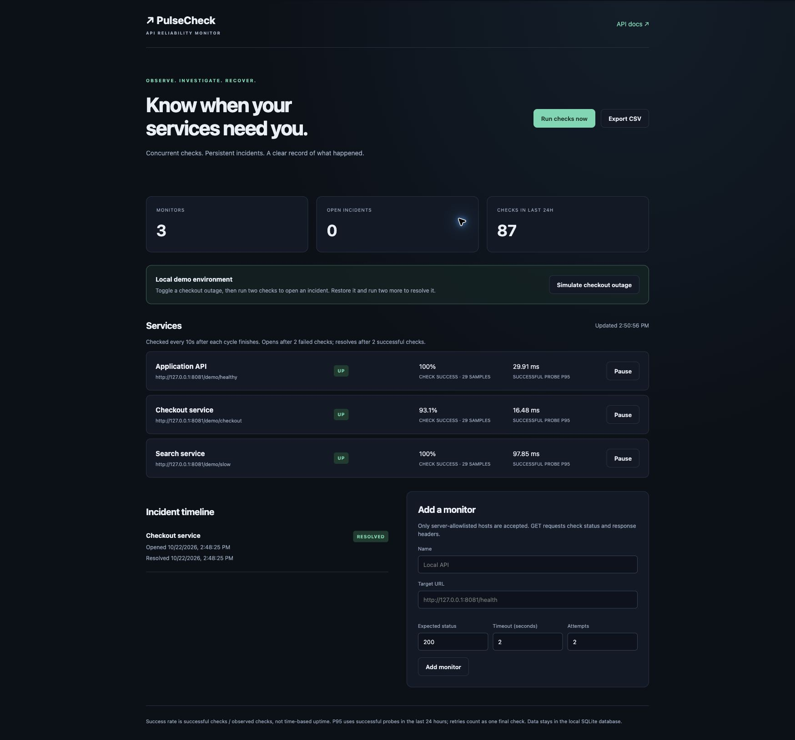

# PulseCheck

A Python API reliability monitor that turns failed HTTP checks into a persistent incident timeline. Designed as a local backend portfolio project: FastAPI, asyncio, HTTPX, SQLite and pytest.



## Try the working demo

Python 3.11 or newer:

```sh
python3 -m venv .venv
source .venv/bin/activate
python -m pip install -r requirements.lock
python -m pip install -e . --no-deps
python -m pulsecheck --demo
```

Open **http://127.0.0.1:8081**. The interactive API specification is at **/docs**.

1. Run checks to collect real HTTP responses from three local demo services.
2. Select **Simulate checkout outage**. Run two checks to open an incident (or let the scheduler do it).
3. Restore checkout. Two successful checks resolve the same incident.
4. Restart with the same database and verify that the incident and check history remain.
5. Export a CSV summary or pause a monitor without deleting its history.

The demo uses real loopback HTTP requests. It is not evidence of real customer traffic or production uptime. The simulated checkout outage flag resets on restart; recorded data persists.

## Backend design

```text
FastAPI endpoints + fixed-delay scheduler
                  |
          one cycle lock
                  |
       bounded asyncio semaphore
                  |
      shared HTTPX connection pool
                  |
  per-attempt deadline + bounded retries
                  |
     SQLite transaction per observation
      check + monitor state + incident
                  |
        dashboard / JSON API / CSV
```

- **Concurrency:** a semaphore limits in-flight probes. A cycle lock prevents the manual endpoint and scheduler from running duplicate cycles simultaneously; manual overlap returns HTTP 409.
- **HTTP behavior:** GET requests stream response headers and close the body without buffering it. Probe latency covers the final attempt through closing the stream. Redirects are not followed. Target credentials are rejected, and environment proxies are ignored.
- **Timeouts:** HTTPX bounds network inactivity. `asyncio.timeout` separately bounds the full attempt, including a transport that never completes.
- **Retries:** network errors, timeouts, HTTP 429 and 5xx responses retry up to the configured attempt limit using bounded exponential backoff. Other unexpected statuses do not retry. An expected 5xx status is a successful check if explicitly configured that way.
- **Incidents:** two consecutive failed final observations open an incident. Two consecutive successful observations resolve it. A unique partial index prevents duplicate open incidents per monitor. A failed retry followed by success is one successful observation, not an outage.
- **Persistence:** one short SQLite transaction writes the check, updates streaks and creates/resolves the incident. SQLite WAL mode supports concurrent readers; blocking DB operations run with `asyncio.to_thread`.
- **Metrics:** check success rate is successful observations divided by observed checks in a rolling 24-hour window. P95 uses the nearest-rank method on successful probe latencies only. Missing samples render as unavailable, not as 100% success or zero latency. These are sampled metrics, not time-based uptime or an SLA.
- **Cancellation:** shutdown cancels the scheduler and closes its HTTP client. Cancelling an in-flight probe does not persist a fabricated failure. Completed observations from a partially cancelled cycle may remain.

## API examples

```sh
curl http://127.0.0.1:8081/api/summary
curl -X POST http://127.0.0.1:8081/api/checks/run
curl http://127.0.0.1:8081/api/incidents
curl 'http://127.0.0.1:8081/api/monitors/1/checks?limit=10'
curl -X POST http://127.0.0.1:8081/api/monitors \
  -H 'Content-Type: application/json' \
  -d '{"name":"Local health","url":"http://127.0.0.1:8081/health","attempts":2,"timeout_seconds":2}'
```

Run without `--demo` for an initially empty monitor list. Set `--db` to use a separate SQLite database. `PULSECHECK_ALLOWED_HOSTS` is a comma-separated exact hostname allowlist, defaulting to `127.0.0.1,localhost`. Persisted targets are checked again against the current allowlist before probing.

## Verify it

```sh
python -m pytest -q
python scripts/verify_demo.py
```

The tests cover incident thresholds and recovery, failure-streak resets, transaction rollback, restart persistence, percentile population and window boundaries, retries, total deadlines, concurrency limits, overlapping runs, cancellation, allowlist changes, redirects, CSV formula injection and API validation. The demo verification script needs the demo server running and leaves one resolved simulated incident in its database.

An optional GitHub Actions workflow example at `docs/ci-tests.yml.example` runs tests on Python 3.11, 3.12 and 3.13. To enable it, add the file as `.github/workflows/tests.yml` using GitHub's web editor or a connection with workflow permission. The current connection cannot upload workflow files. No remote CI run or result is claimed.

## Scope and tradeoffs

- Local and trusted-user only. The supplied CLI binds to loopback. There is no authentication, tenant isolation, outbound proxy sandbox or DNS-rebinding defense. Do not expose this monitor API publicly as-is.
- Use one Uvicorn worker. Each process would otherwise own a scheduler. A larger deployment would need an external scheduler or distributed lease and a shared database.
- SQLite and a rolling-window query are a deliberate small-project choice. There is no retention/compaction job yet; the history grows until you manage the database.
- The scheduler waits a fixed interval after a cycle finishes. It does not guarantee wall-clock execution times or catch up checks missed while the process was stopped.
- No alert delivery or response-body assertions yet. It currently checks HTTP status and headers, not application correctness or end-to-end user flows.

## References

- [FastAPI lifespan resources](https://fastapi.tiangolo.com/advanced/events/)
- [HTTPX timeout semantics](https://www.python-httpx.org/advanced/timeouts/)
- [SQLite partial indexes](https://www.sqlite.org/partialindex.html)

Developed with AI assistance. See [INTERVIEW-GUIDE.md](INTERVIEW-GUIDE.md) for an explanation and exercises to complete before presenting the project in interviews.
